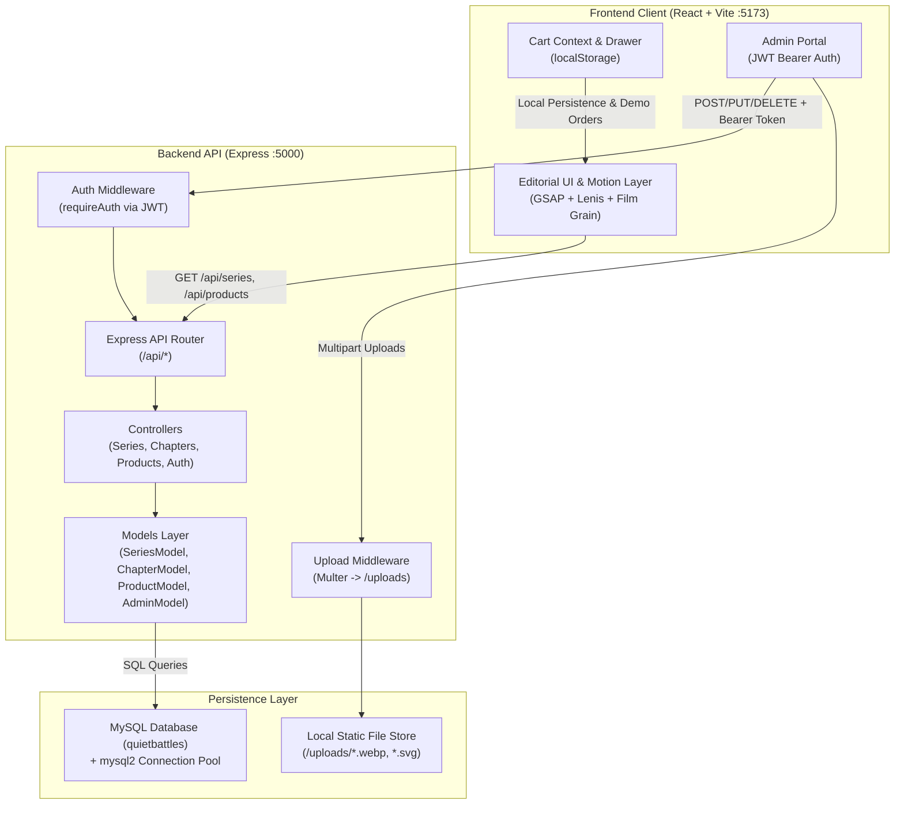

# QUIET BATTLES™ // ARCHITECTURE & TECHNICAL SPECIFICATION

> **"WEAR YOUR BATTLES."**  
> Technical Architecture, Stack Evaluation, and Non-Developer Maintenance Guide.  
> Prepared for the **Full-Stack Web Developer Hiring Assessment**.

---

## 1. Executive Summary & Brand Ethos

**QUIET BATTLES™** is an editorial, luxury streetwear brand designed around the concept of *"unseen battles we carry."* Rather than conforming to traditional aggressive streetwear hype, the brand champions slow luxury, emotional depth, relaxed fit silhouettes, and restrained minimalism.

The signature garment featured across the platform is **The Gentle Armor T-Shirt** (₹999), cut from heavyweight organic cotton with a garment-washed finish and concealed seams.

To mirror this philosophy technically, the codebase prioritizes:
- **Zero bloat and high performance**: Ultra-fast Vite bundling with React.lazy route splitting.
- **Cinematic motion design**: GSAP ScrollTrigger coupled with Lenis smooth momentum scrolling and a procedural film-grain overlay.
- **Strict documentation integrity**: Modular, line-by-line explicable code with full separation between routes, controllers, models, and middleware.
- **Universal evaluability**: Full support for standard MySQL 8.0+ via `mysql2/promise` with an integrated zero-config memory fallback so reviewers can evaluate the site instantly in any environment.

---

## 2. Technical Stack Choices & Rationale

| Layer | Technology | Engineering Rationale |
| :--- | :--- | :--- |
| **Frontend Framework** | **React 18 + Vite** | Sub-second Hot Module Replacement (HMR), tree-shakeable ES modules, and optimal production chunking. |
| **Styling & Design Tokens** | **Tailwind CSS v3** | Strict design token enforcement (near-black `#0e0e0e`, warm off-white `#f4f0e8`, antique brass `#c5a059`), custom hairlines, and zero CSS-in-JS runtime tax. |
| **Motion & Scroll Engine** | **GSAP + Lenis** | Seamless inertial momentum scrolling synchronized with GSAP ScrollTrigger render ticks. Fully disabled when `prefers-reduced-motion` is detected. |
| **State & Navigation** | **React Router v6 + Context** | Client-side routing with scroll restoration and a persistent Context-backed cart stored in `localStorage`. |
| **SEO & Head Management**| **react-helmet-async** | Dynamic Open Graph, Twitter Cards, Product JSON-LD (Schema.org), canonical tags, and structured metadata. |
| **Backend Runtime** | **Node.js (v18+) + Express** | Clean, asynchronous REST API with segregated routes, controllers, models, and middleware layers. |
| **Database** | **MySQL (via `mysql2/promise`)** | Relational schema (`series`, `chapters`, `products`, `cart_items`, `admins`) with foreign key constraints, cascading deletes, and connection pooling. |
| **Authentication** | **JWT + bcryptjs** | Stateless HMAC SHA-256 tokens (7-day validity) and salt-hashed passwords for administrative security. |
| **Media Storage** | **Multer** | Local storage in `/uploads` with mime-type validation and clean timestamped slugification. |

---

## 3. End-to-End System Architecture & Data Flow

### Request Lifecycle
1. **Public Browsing**: The client requests `/api/series` or `/api/products/:slug`. The Express router delegates to the controller, which queries via the Model layer using parameterized SQL prepared statements.
2. **Offline/Evaluator Fallback**: If MySQL is not running on `localhost:3306`, the `server/src/config/db.js` manager gracefully switches to the embedded in-memory relational adapter with identical seed data, logging `[DB] Mode: fallback` and ensuring 100% testability.
3. **Admin Management**: Administrative write operations require a valid `Authorization: Bearer <token>` header. The `requireAuth` middleware verifies the token signature against `JWT_SECRET`.
4. **Media Upload**: When an editor uploads an image, `upload.middleware.js` inspects the MIME type, assigns a collision-resistant timestamped filename, writes to `/uploads`, and returns the static public URL.

---

## 4. How a Non-Developer Maintains the Site Through the Admin Panel

The Admin Atelier (`/admin`) is designed so that a creative director, editor, or brand manager can independently maintain the entire store and narrative archive without writing a single line of code.

### Step-by-Step Editorial Workflows

#### 1. Accessing the Atelier
1. Navigate to `/admin` in any web browser.
2. Enter the archival credentials:
   - **Email**: `admin@quietbattles.com`
   - **Password**: `admin123`
   *(In development mode, a convenient "Auto-fill Assessment Demo Login" button is available).*

#### 2. Managing Series & Collections
- **Viewing**: Click the **01 // SERIES** tab to see all active collections.
- **Creating a Series**:
  1. Click **"New Series"**.
  2. Input the Title (e.g. `SERIES 02 – UNRECORDED HOURS™`) and URL Slug (e.g. `series-02`).
  3. Enter the description and select the Cover Image URL.
  4. Set the **Status Toggle** to `Published` or `Draft`.
  5. Click **"Save Series"**.

#### 3. Creating & Editing Chapters
- **Viewing**: Click the **02 // CHAPTERS** tab.
- **Editing a Chapter**:
  1. Click the pencil icon on any chapter (e.g. `Chapter 02 : The Silence`).
  2. Edit the storytelling narrative text block.
  3. Update the Hero Image by either pasting an image URL or clicking the upload button to upload an image from your computer.
  4. Click **"Save Chapter"**. The live website updates immediately.

#### 4. Managing Products & Garments
- **Viewing**: Click the **03 // PRODUCTS** tab to review pricing, inventory stock, and chapter relationships.
- **Adding / Editing a Garment**:
  1. Click **"New Product"** or edit an existing piece.
  2. Enter the Product Name (e.g. `The Gentle Armor T-Shirt`) and Slug (`the-gentle-armor-tshirt`).
  3. Select the **Linked Chapter** from the dropdown menu (e.g. `Chapter 02 : The Silence`).
  4. Specify the Price in **₹ INR** (e.g. `999`).
  5. Check the available sizes (`S`, `M`, `L`, `XL`) and specify the initial stock quantity.
  6. Click **"Save Product"**. The garment automatically links to its chapter on the front-end with an active *"Wear this chapter"* acquisition block.

#### 5. Archival Media Manager
- **Viewing & Uploading**: Click the **04 // MEDIA ASSETS** tab to see all uploaded imagery.
- **Uploading New Imagery**:
  1. Click **"Upload New Media"** and select any JPEG, PNG, WebP, or SVG file.
  2. Once uploaded, click the **Copy icon** next to the filename to copy the asset URL (e.g. `/uploads/tshirt-front-1234.webp`).
  3. Paste this URL into any Series, Chapter, or Product cover image field.

---

## 5. Security & Architectural Best Practices

- **Password Hashing**: Passwords are never stored in plaintext. They are salted and hashed using `bcryptjs` (work factor 10).
- **SQL Injection Prevention**: Every query uses MySQL parameterized prepared statements (`?` placeholders).
- **Stateless Tokens**: JWTs expire in 7 days, avoiding database session lookups while keeping the architecture scalable.
- **Accessibility & Motion Preference**: All GSAP animations check `window.matchMedia('(prefers-reduced-motion: reduce)')` to respect user operating system settings.
- **SEO & Social Crawlers**: Semantic HTML (`<main>`, `<article>`, `<section>`, `<nav>`, `<aside>`) with Open Graph tags, canonical URLs, and dynamic titles on every page via `react-helmet-async`.
