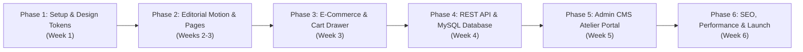

# QUIET BATTLES™ // PROJECT QUOTATION & SCOPE OF WORK

> **Client**: Quiet Battles™ Fashion Atelier  
> **Project**: Editorial E-Commerce & Storytelling Web Platform  
> **Currency**: Indian Rupee (₹ INR)  
> **Version**: 1.0 (Commercial Proposal)  
> *All rates and line items below are editable estimates for client review and scoping.*

---

## 1. Project Overview & Objectives

Develop a bespoke, editorial luxury e-commerce platform for **QUIET BATTLES™** ("WEAR YOUR BATTLES."). The platform blends emotional, long-form storytelling with high-performance streetwear e-commerce, custom motion design, an intuitive administrative CMS, and robust relational database architecture.

---

## 2. Project Phases, Timeline & Deliverables

| Phase | Milestone | Timeline | Deliverable Summary |
| :--- | :--- | :--- | :--- |
| **Phase 1** | Brand System & Foundational Setup | Week 1 | Design tokens, typography, full-stack scaffolding, navigation shell |
| **Phase 2** | Editorial Motion & Archival Pages | Weeks 2–3 | Preloader, GSAP parallax hero, Archive, Series 01, Chapter 02 |
| **Phase 3** | E-Commerce Architecture & Cart | Week 3 | Product page, size selector, CartContext, slide-in drawer |
| **Phase 4** | Express REST API & Database | Week 4 | MySQL relational schema, seed data, JWT auth, routes & controllers |
| **Phase 5** | Admin CMS Atelier Portal | Week 5 | Protected CRUD for Series, Chapters, Products, Multer media manager |
| **Phase 6** | SEO, Performance & Deployment | Week 6 | JSON-LD, Lighthouse audit, Vercel/Render/Railway deployment setup |

### Phase 1: Brand System, Typography & Foundational Setup (Week 1)
- **Deliverables**:
  - Full-stack project scaffolding (`/client` and `/server`).
  - Tailwind design tokens: Near-black (`#0e0e0e`), warm off-white (`#f4f0e8`), antique brass (`#c5a059`), and stone grey spectrum.
  - Editorial typography pairing: Cormorant Garamond / Playfair Display and Inter.
  - Global navigation shell, full-screen mobile menu overlay, and procedural film-grain overlay.

### Phase 2: Cinematic Motion & Editorial Pages (Weeks 2–3)
- **Deliverables**:
  - 0–100% numerical preloader with brand crest reveal.
  - Full-screen parallax hero with GSAP ScrollTrigger reveals.
  - Brand Philosophy storytelling section (`01 // THE PHILOSOPHY`).
  - The Archive catalog page (`/archive`) and Series 01 overview page with 5 chapters (`/archive/series-01`).
  - Immersive Chapter storytelling page (`/archive/series-01/the-silence`) with alternating tactile studies and pull quotes.

### Phase 3: E-Commerce Architecture & Cart Drawer (Week 3)
- **Deliverables**:
  - Luxury Product Page (`/product/the-gentle-armor-tshirt`) with multi-image gallery (>60% layout width) and 4 selectable thumbnails.
  - Size selector with validation (S, M, L, XL), quantity stepper, and sizing measurement guide modal.
  - Slide-in Cart Drawer using Context + `localStorage` persistence with demo checkout workflow.
  - Price formatting in ₹ INR (`₹999`) with complimentary archival dispatch tags.

### Phase 4: Express REST API & Database Engineering (Week 4)
- **Deliverables**:
  - Express.js REST API with separated routes, controllers, models, and middleware.
  - MySQL 8.0+ relational schema (`series`, `chapters`, `products`, `cart_items`, `admins`) with foreign keys.
  - Zero-setup intelligent fallback database adapter for frictionless local review.
  - Multer multipart image upload pipeline storing files in `/uploads`.
  - JWT authentication and bcrypt password salting/hashing.

### Phase 5: Admin Atelier CMS (Week 5)
- **Deliverables**:
  - Protected admin portal (`/admin`) with login authentication.
  - Full CRUD for Series (titles, slugs, cover images, published/draft status).
  - Full CRUD for Chapters (story prose, sort order, hero image upload).
  - Full CRUD for Products (name, price in ₹, sizes, inventory stock, chapter relations).
  - Archival Media Manager with direct upload and 1-click URL copying.

### Phase 6: SEO, Accessibility, Audit & Production Launch (Week 6)
- **Deliverables**:
  - `react-helmet-async` meta tags, Open Graph tags, Twitter Cards, and Product JSON-LD (Schema.org).
  - Dynamic `sitemap.xml` and `robots.txt`.
  - WCAG AA contrast compliance and touch targets (minimum 44px).
  - Production deployment configuration (`DEPLOYMENT.md`), verification test suite, and launch handoff.

---

## 3. Commercial Cost Table (Editable Rates)

| Item | Phase & Scope Description | Estimated Timeline | Cost (₹ INR) |
| :---: | :--- | :---: | :---: |
| **01** | **Design System & Architecture Setup** Palette tokens, typography scale, film-grain, responsive navbar & footer. | 1.0 Week | ₹45,000 |
| **02** | **Motion Engineering & Editorial Pages** 0–100% preloader, Lenis smooth scrolling, GSAP ScrollTrigger hero, Archive & Chapter pages. | 1.5 Weeks | ₹75,000 |
| **03** | **Product Experience & Cart System** Multi-image gallery (>60% width), size selector validation, slide-in drawer, `localStorage` persistence. | 1.0 Week | ₹50,000 |
| **04** | **Backend API & Database Architecture** Express REST API, MySQL 8 schema, connection pooling, zero-config evaluator mode, Multer uploads. | 1.0 Week | ₹65,000 |
| **05** | **Admin Atelier CMS Dashboard** JWT authentication, Series/Chapter/Product CRUD, draft/published toggle, image asset manager. | 1.0 Week | ₹55,000 |
| **06** | **SEO, Performance & Deployment Launch** Product JSON-LD, sitemap, robots, WCAG AA compliance, Vercel/Render/Railway deployment. | 0.5 Weeks | ₹30,000 |
| **—** | **Total Project Investment** | **6.0 Weeks** | **₹3,20,000** |

---

## 4. Payment Milestones & Terms

- **Milestone 1 (30%)**: Project initiation, design system setup, and database schema approval (`₹96,000`).
- **Milestone 2 (40%)**: Editorial pages, motion engineering, product page, cart drawer, and API implementation (`₹1,28,000`).
- **Milestone 3 (30%)**: Admin CMS, QA testing, SEO verification, and production deployment handoff (`₹96,000`).

---

## 5. Ongoing Support & Maintenance (Optional Retainer)

- **Monthly Retainer**: ₹25,000 / month
  - Weekly database backups and security patch updates.
  - Content uploads (up to 4 new chapters and products per month).
  - Core Web Vitals monitoring and performance optimization.
  - Priority bug fixes (SLA: 12-hour response).

